# Permission Studio

**See, change and understand Salesforce access without leaving VS Code.**

Permission Studio is a Visual Studio Code extension for Salesforce admins and developers. It puts permission sets, permission set groups and profiles on one screen next to your code: edit them like Setup, change many at once, find out who can do what and why, and review every change before it reaches the org.

[](https://github.com/nikeshvarma/Permission-Studio/releases)
[](https://github.com/nikeshvarma/Permission-Studio/actions/workflows/ci.yml)
[](LICENSE)
[](https://code.visualstudio.com/)
[](https://developer.salesforce.com/tools/salesforcecli)

Developed by Nikesh Varma.

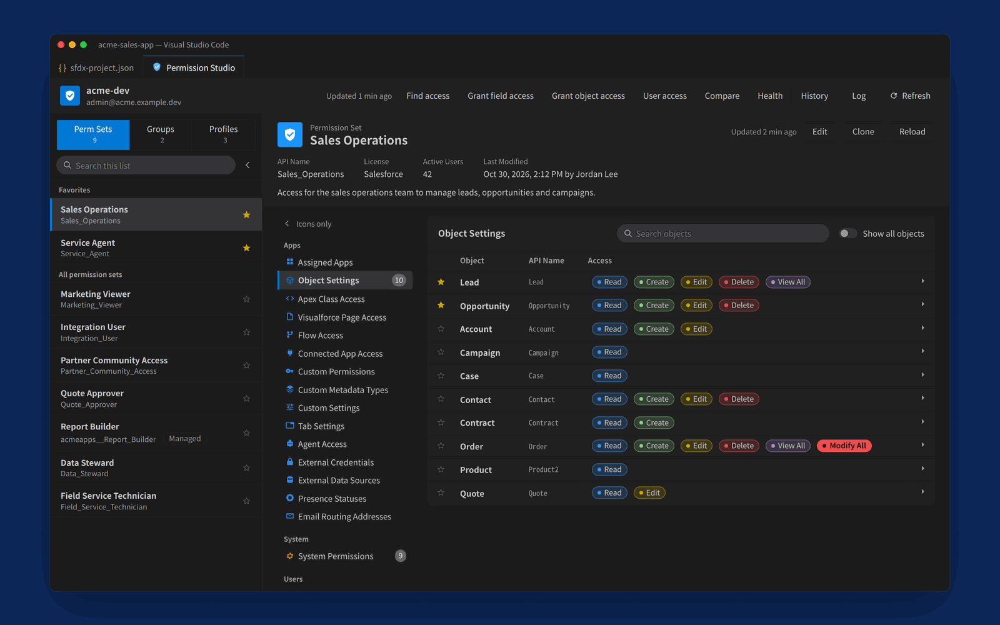

## Contents

- [The problem](#the-problem)
- [How Permission Studio helps](#how-permission-studio-helps)
- [Key features](#key-features)
- [Getting started](#getting-started)
- [Commands](#commands)
- [What you can see and change](#what-you-can-see-and-change)
- [How it works](#how-it-works)
- [Safety and privacy](#safety-and-privacy)
- [Keyboard shortcuts](#keyboard-shortcuts)
- [Settings](#settings)
- [Limitations](#limitations)
- [FAQ](#faq)
- [Troubleshooting](#troubleshooting)
- [Contributing](#contributing) · [Development](#development) · [Changelog](#changelog) · [License](#license)

## The problem

Access is where Salesforce work slows down. In Setup, every question and every change is a walk through pages:

- **Changing access is repetitive.** Giving new fields to eight permission sets means opening each one, finding the object, editing, ticking and saving, eight times over.
- **"Who can edit this field?" has no quick answer.** Access can come from a profile, any number of permission sets, a group, or an org-wide permission such as Modify All Data. Checking means opening each of them, or writing SOQL.
- **Mistakes are easy and quiet.** Setup saves the moment you click. There is no list of what you are about to change, no warning that a permission reaches every record in the org, and no undo.
- **Groups and profiles hide their effects.** A group's access is the sum of its permission sets minus its muting; a user's access is the sum of everything assigned to them. Neither is shown in one place.
- **Paperwork is manual.** A ticket or design document needs a record of what changed, which means screenshots or retyping.
- **Orgs drift apart.** Comparing a permission set in a sandbox with the same one in production is done side by side, by eye.

## How Permission Studio helps

| Task | In Setup | With Permission Studio |
| --- | --- | --- |
| Give three new fields Read and Edit across eight permission sets and profiles | Open each item, Object Settings, the object, Edit, tick, Save: eight times | **Grant field access**: pick the fields, pick the items, see what each has now, review, save once |
| Find out who can edit `Lead.Rating`, and through what | Check every profile, permission set and group, or write SOQL | **Find access**: type `Lead.Rating`; every user, the sources that grant it, and **Why?** for each user |
| See everything one user can do | Open the user, then each profile, permission set and group they hold | **User access**: one view, with the source of every permission |
| Compare a permission set in a sandbox with production | Two browser windows, compared by eye | **Compare**: every difference, filterable and copyable as a table |
| Turn off one permission for a group's users | Find or create the muting permission set, edit it, save | **Muted Permissions**: tick it, review, save |
| Record a change for an ADO or Jira ticket | Screenshots, or retyping | **Copy summary** as a Markdown table, or **Export** to Excel, with the ticket number |
| Undo a mistake | Redo it by hand, from memory | **Undo** from History, or from the notice after saving |
| Check what changed on a permission set recently | Setup Audit Trail, filtered by hand | **Changes in Setup**, on the item itself |
| Find what to clean up: unused permission sets, inactive users' assignments, admin access on integration users | Reports and SOQL, one question at a time | **Health**: every finding on one page, with fixes saved after a review |

## Key features

### Edit like Setup, with safety Setup doesn't have

Every section of a permission set or profile is on one screen: object, field, record type and system permissions; Apex class, Visualforce page, flow, app and connected app access; custom permissions, custom metadata types, custom settings and tab settings. Salesforce's permission rules apply as you click: Edit brings Read, Modify All brings everything below it, and system and custom permissions follow the dependency rules read from your org, with a note under the checkbox saying what else changed. Changes are highlighted and counted, and stay until you save, even if you close the tab or reload VS Code.

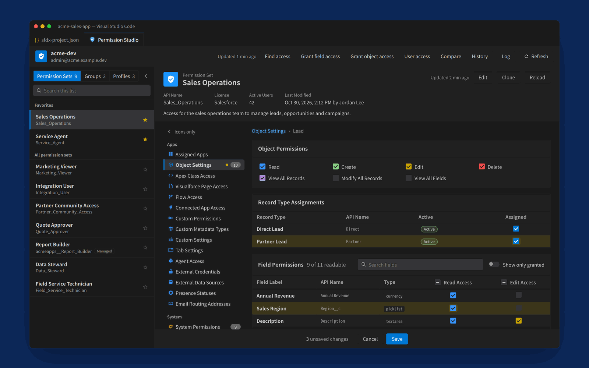

### Review before anything is saved

Save opens a review that starts with the impact: how many changes, how many users they reach, which high-impact permissions are being granted (Modify All Data, View All Data, Use Any API Client and others are spelled out in plain words), and what access is being removed. Then every change on one line, where any one can be dropped. Add a ticket number and it follows the save into History and copied summaries. On a production org you type the org's name to confirm.

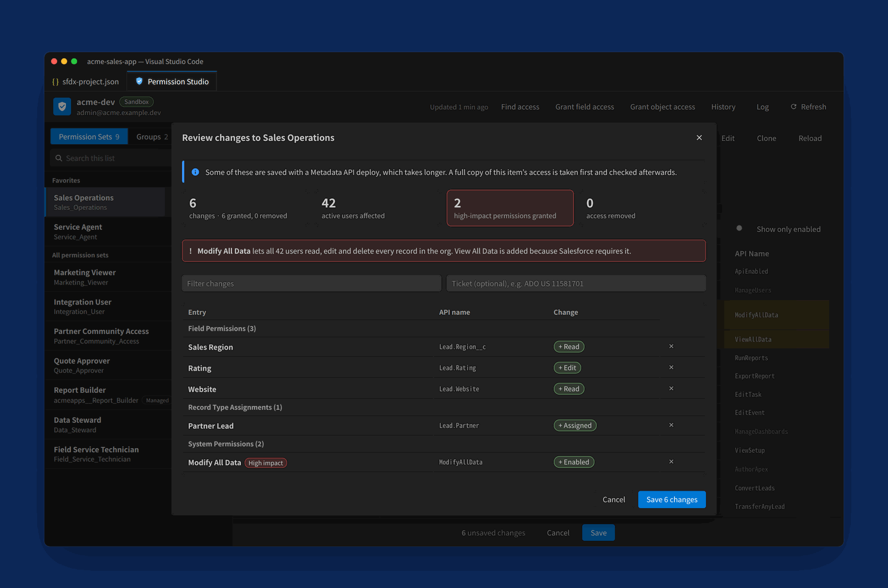

### Find out who has access, and why

Type an object or a field (`Lead.Rating`), or pick a system or custom permission. Filter by profile, licence, source or user status. **Why?** shows exactly how each user gets the access, including through a group's member permission sets. From the results, remove the access from chosen sources, or grant it to more. View All Data, Modify All Data and View All Fields are counted, and recent searches are a click away.

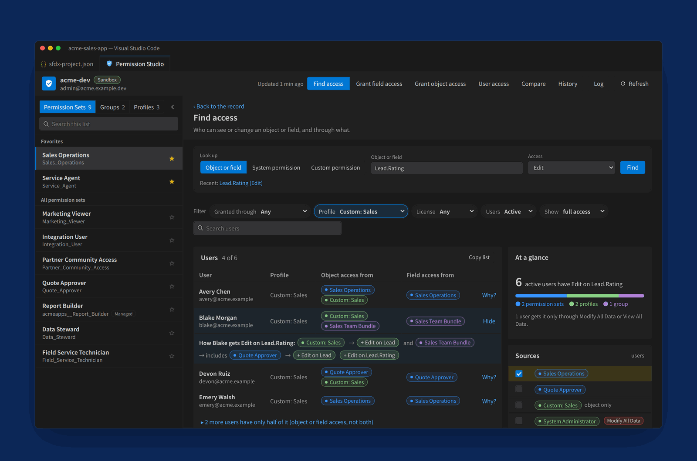

### Grant access in bulk

**Grant field access** gives fields Read or Read and Edit across many permission sets and profiles at once, showing what each already has and what will change, with a running total of the users reached. **Grant object access** sets object permissions and record types in one grid, including profile defaults. Access is only ever added. Save your choices as a template for the next new field.

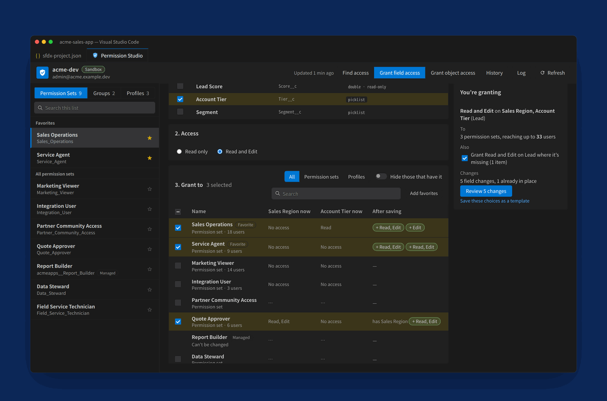

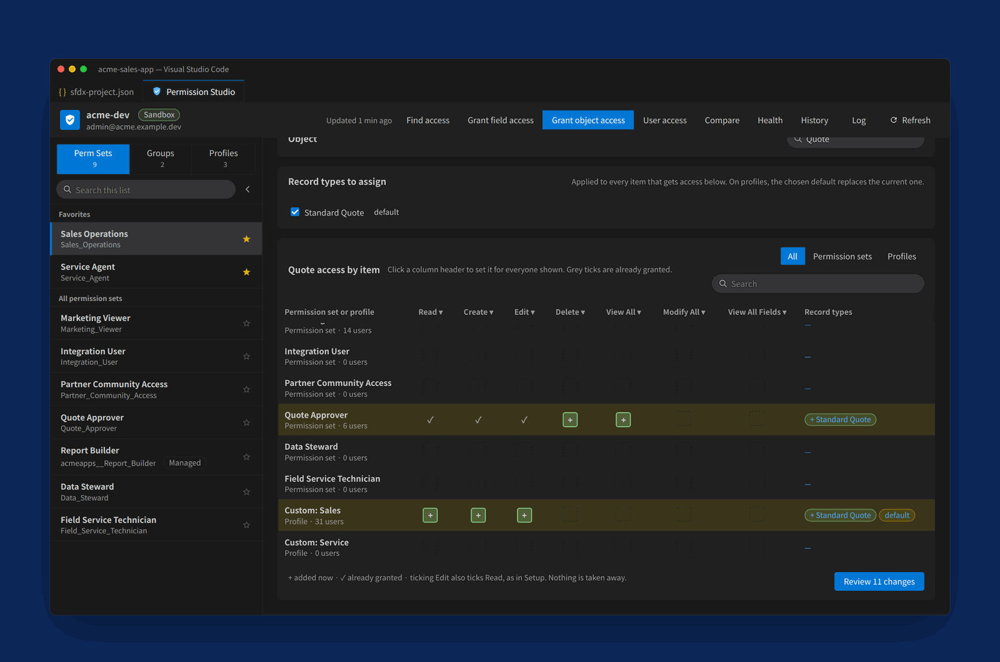

### See everything one user can do

**User access** adds up a user's profile, permission sets and groups (with expiry dates) and their permission set licences, then shows the object, field, system and custom permissions those come to. Coloured dots show which source grants each one.

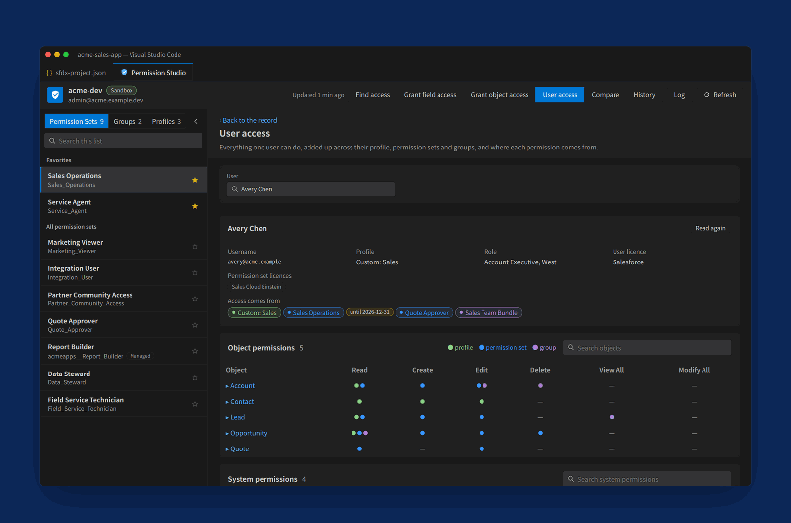

### Compare items and orgs

Compare two permission sets, profiles or groups in this org, or the same one in another org the Salesforce CLI is signed in to: object, field, system, app, Apex, Visualforce, flow, custom permission, custom metadata, custom setting and tab differences, filterable by area and copyable as Markdown.

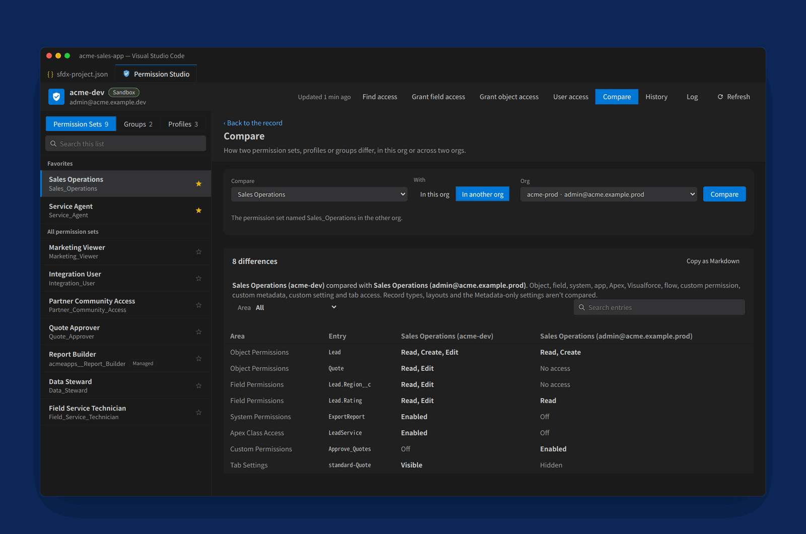

### Permission set groups, including muting

Add or remove a group's member permission sets while Salesforce recalculates the group in the background; the status shows while it runs and the group's access refreshes when it finishes. Under **Muted Permissions**, mute object, field and system permissions the group's permission sets grant, without changing the permission sets themselves. A group without a muting permission set gets one in a click.

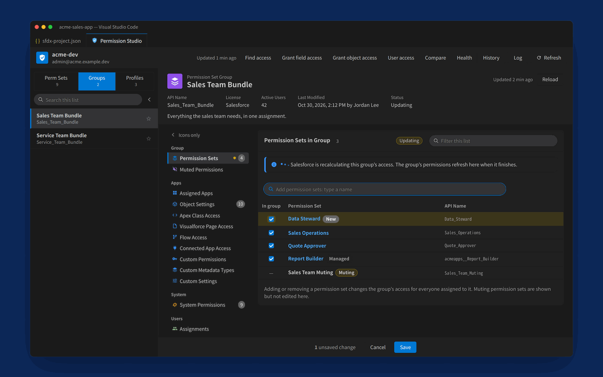

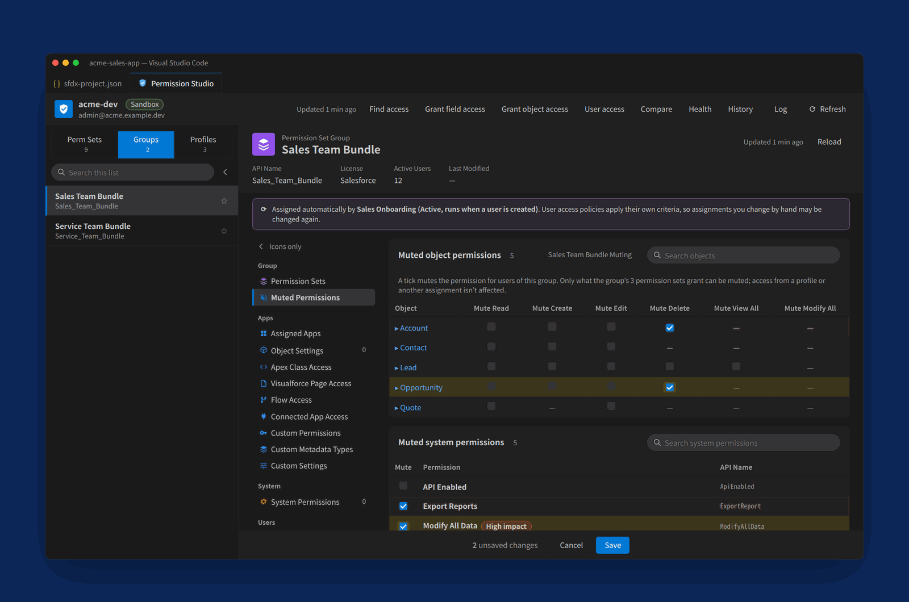

### Profiles, assignments and the newer kinds of access

- **Profile settings:** default app, login flow, data category visibility, password policy and session settings; also page layout assignments, login hours and login IP ranges, and the profile's users.
- **Newer kinds of access:** Agent Access (Agentforce employee agents), External Credential Principal Access, External Data Source Access, Service Presence Statuses Access and Email Routing Address Access, for permission sets and profiles. A kind the org doesn't have says so.
- **Assignments:** add or remove users, with expiry dates and a warning when one expires soon. Users who can't hold a permission set's licence are flagged before you save, and a missing permission set licence can be assigned in the same save.
- **User access policies:** a permission set or group shows the policies that assign it automatically, and the review warns before you remove an assignment a policy may give back.
- **Rename and clone** permission sets, or **copy a profile to a new permission set**, Salesforce's recommended permission-set-led model.

### Access health check

The **Health** button in the top bar reads the whole org (every permission set, group and profile, whichever lists you show) and lists what needs cleaning up or a second look:

- **Integration users with admin access:** API Only users, and users on an integration licence, who hold Modify All Data, View All Data, Manage Users or other admin permissions.
- **High-impact permissions:** everyone who holds Modify All Data, View All Data, Manage Users, Author Apex and the other org-wide permissions, and through which profile, permission set or group.
- **Assignments to inactive users:** remove them in one reviewed save.
- **Assignments that expire soon** (within 7 to 90 days): extend them by 30, 90 or 180 days from their current expiry date.
- **Unused permission sets, permission set groups and profiles:** no active users (and, for permission sets, in no group). A Flow or a user access policy may still assign one when it runs, so check before deleting it in Setup.
- **Permission sets that grant nothing:** no object, field, system, tab, app, Apex or other record-based access.

Summary cards give the counts at a glance; click one to jump to its finding. Built for large orgs: a long finding shows 50 rows at a time (**Show more** adds 100), and **Select all** takes the whole finding, including rows not shown, so thousands of inactive users' assignments can be removed in one go. Fixes go through the same review, snapshot and undo as every other save. **Export** the findings as one Excel workbook: a summary and one sheet per finding.

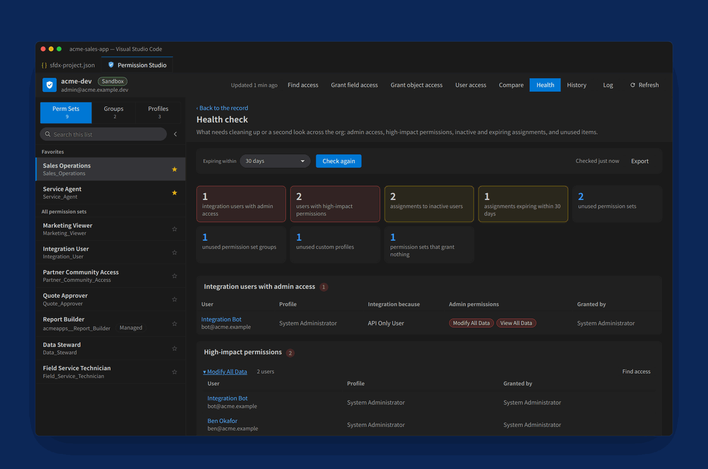

### Exports

Every analysis screen has an **Export** button that saves one Excel workbook, with as many sheets as the subject needs:

| Screen | Sheets in the workbook |
| --- | --- |
| Health check | Summary, then one sheet per finding |
| User access | Summary, Sources, Object, Field, System and Custom permissions, each with the sources that grant them |
| Compare | Differences, then everything each side grants |
| Find access | Users, Sources, Half access, Inactive users |
| History | Saves, and every change (the selected saves, or everything shown) |

Each sheet starts with what it is, the org, when it was exported and the filters used, so a sheet forwarded on its own still makes sense. The data is a real Excel table (banded rows, filter buttons, sortable) with the header frozen, cells are coloured like the screen (Read, Edit, Delete, View All and Modify All; high-impact permissions in red), and permission sets, profiles, groups and users link to their pages in Setup. Very large results are split across sheets to stay within Excel's limits. After saving, **Open** or **Show in folder**.

### History, undo and paperwork

Every save is kept in History with its changes, ticket and result, alongside changes made in Setup (from Setup Audit Trail). Undo any save, copy saves as a Markdown table for a ticket, or export them to Excel for a design document or a release note. Each item also has a **Changes in Setup** section: who changed it in Setup recently, and what.

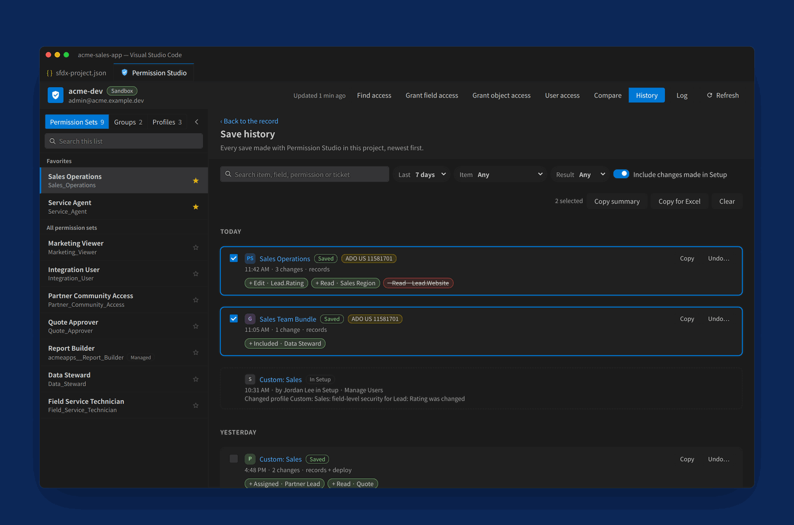

### Built for everyday work

- **Always current:** each time the page opens, everything is read from the org again; a background refresh keeps it current while you work. Unsaved changes are kept.
- **Fast:** screens open at once from what you saw last time and refresh in the background, using the Salesforce CLI's own connection inside VS Code. Long lists load progressively; the last screens stay readable offline.
- **Easy to read:** colour-coded permissions, **High impact** tags on org-wide system permissions, **Managed** and **Session-based** tags, and **Sandbox** and **Production** badges on the org.
- **Steady while you work:** ticking a checkbox, choosing a section or removing a change in the review never moves a list or the menu; everything stays where you left it.
- **Fits a laptop screen:** the layout follows the space the page has. When it's narrow, the section menu shows icons only and the item list can be hidden to a rail.
- **Keeps your source in step:** optionally update the project's `.permissionset-meta.xml` or `.profile-meta.xml` after a save, ready to commit.
- **One consistent look:** buttons are rectangles; dropdowns, search boxes, filters and tags are pills; cards, dialogs and notices share the same corners; every checkbox, radio button and table follows one style.
- **Small things that add up:** favorites that load first, copy any API name with one click, keyboard shortcuts, **Open in Permission Studio** from any permission set, profile or group file, and light and dark themes.

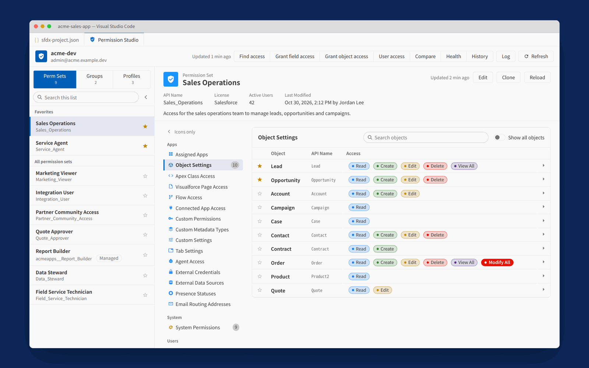

## Getting started

### Requirements

- VS Code 1.85 or later
- Salesforce CLI v2 (`sf`), signed in to your org
- A Salesforce project (a folder with `sfdx-project.json`) with a default org: `sf config set target-org <alias>`

### Install

1. Download the latest `.vsix` from the [Releases](https://github.com/nikeshvarma/Permission-Studio/releases) page.
2. In VS Code, open the Extensions view, then **…** › **Install from VSIX…**, and pick the file. Or run `code --install-extension permission-studio-<version>.vsix`.

### First run

1. Open your Salesforce project. Permission Studio starts loading in the background straight away.
2. Click the shield in the status bar, or run **Permission Studio: Open** from the Command Palette.
3. Pick a permission set, group or profile from the list, and its sections appear on the right.

Permission Studio always works on the project's default org. Change it the usual way (`sf config set target-org <alias>`, or the org picker in the Salesforce extensions) and the screen switches to the new org on its own. No passwords, tokens or extra sign-in.

## Commands

| Command | What it does |
| --- | --- |
| **Permission Studio: Open** | Open the Permission Studio page (also the shield in the status bar) |
| **Permission Studio: Open Item…** | Pick a permission set, group or profile by name and open it |
| **Open in Permission Studio** | From a permission set, profile or group file (Explorer, editor title or tab menu): open that item |
| **Permission Studio: Refresh** | Read everything from the org again |
| **Permission Studio: Show Log** | Connection steps, fallbacks and Salesforce's own error messages |
| **Permission Studio: Clear Cache** | Empty the saved screens for every org |

## What you can see and change

| Section | Permission sets | Profiles | Saved as |
| --- | --- | --- | --- |
| Assigned Apps; Apex Class, Visualforce Page, Flow and Connected App Access; Custom Permissions; Custom Metadata Types; Custom Settings | Yes | Yes | records |
| Object Settings: object and field permissions | Yes | Yes | records |
| Object Settings: record type assignments | Yes | Yes | Metadata API deploy |
| Object Settings: page layout assignments | — | Yes | Metadata API deploy |
| Tab Settings | Yes | Yes | records |
| System Permissions | Yes | Yes | records |
| Login Hours and Login IP Ranges | — | Yes | Metadata API deploy |
| Agent Access, External Credential Principal Access, External Data Source Access, Service Presence Statuses Access, Email Routing Address Access | Yes | Yes | Metadata API deploy |
| Profile settings: default app, login flow, data category visibility | — | Yes | Metadata API deploy |
| Profile settings: password policy and session settings | — | Yes | Metadata API deploy (the profile's own policy) |
| Assignments, with expiry dates | Yes, and groups | Read-only list of users | records |
| Permission set licences, when an assignee lacks one | Yes | — | records (assigned in the same save) |
| Member permission sets | — | — | records (groups only) |
| Muted permissions: object, field and system | — | — | Metadata API deploy (groups only, the group's muting permission set) |
| Changes in Setup (Setup Audit Trail) | Read-only | Read-only | — |
| Health check fixes: remove assignments of inactive users, extend expiring assignments | Yes, and groups | — | records (reviewed, like every save) |

A group's access comes from its member permission sets, so on a group you change its members, assignments and muting, and edit the permission sets themselves for anything else. Managed-package permission sets and groups are read-only apart from their assignments. Standard profiles are read-only.

## How it works

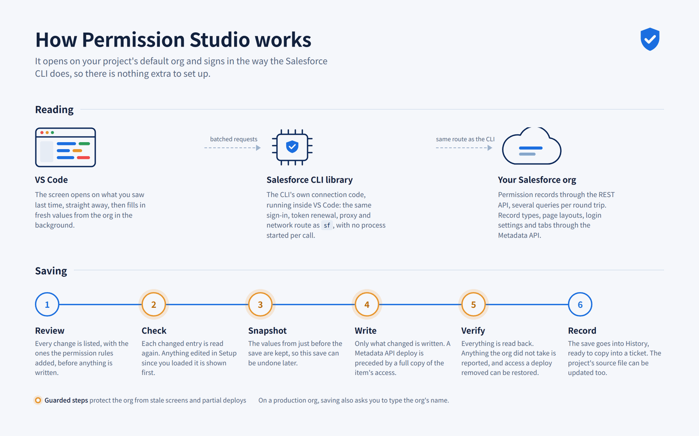

**Reading.** Permission Studio loads the Salesforce CLI's own connection library and runs it inside VS Code, so it uses the CLI's sign-in, token renewal, proxy settings and network route without starting an `sf` process for each call. If that isn't possible it falls back to direct REST calls, then to `sf` processes, and says so.

**Saving.** Every save follows the same six steps:

1. **Review:** you see every change and its impact, and confirm.
2. **Check:** every changed entry is read again, so an edit someone made in Setup since you loaded the screen is never silently overwritten.
3. **Snapshot:** the values from just before the save are kept for undo.
4. **Write:** only the records that change are written, in one request where possible. Settings that only exist in metadata go through the Metadata API; a deploy that changes an item's own access is preceded by a full copy of that access and checked afterwards.
5. **Verify:** everything is read back, and anything the org did not take is reported.
6. **Record:** the save goes into History, with its ticket.

## Safety and privacy

- **No credentials:** Permission Studio never asks for a password or stores a token. It uses the session the Salesforce CLI already holds, and tokens never appear in the log.
- **Review and confirm:** nothing is written without the review, and production asks you to type the org's name. Whether an org is production is read from the org itself, never from its alias.
- **No silent overwrites:** a change made in Setup after you loaded the screen is detected and shown before anything is saved.
- **Undo:** every save keeps a snapshot of the values just before it.
- **Cached screens:** kept in the extension's own storage, one folder per org, never in your project, and cleared when a new version is installed. **Permission Studio: Clear Cache** empties it.
- **Snapshots and the change log:** written to `.permstudio/` in the project, for History and undo. Add `.permstudio/` to your `.gitignore`.
- **No telemetry:** Permission Studio talks only to your org. Nothing is sent anywhere else.
- **Open source:** every line is in this repository, under the MIT licence.

## Keyboard shortcuts

| Keys | What they do |
| --- | --- |
| `Ctrl+S` / `Cmd+S` | Open the review; press again to save |
| `Esc` | Close a dialog, or leave a tool page |
| `/` | Jump to the search box |

## Settings

| Setting | Default | Purpose |
| --- | --- | --- |
| `permStudio.lists.show` | `["permissionSet", "profile"]` | Which lists to show and load: `permissionSet`, `group`, `profile` |
| `permStudio.autoRefresh.enabled` | `true` | Refresh in the background while VS Code has focus |
| `permStudio.autoRefresh.minutes` | `5` | Minutes between background refreshes, 1 to 30 |
| `permStudio.refreshOnOpen` | `true` | Read everything again each time the page opens, or comes back into view after a minute or more |
| `permStudio.defaults.onlyEnabledAccess` | `true` | Start access lists (Assigned Apps, Apex Class Access, Custom Permissions, Agent Access and the others) with **Show only enabled** on |
| `permStudio.defaults.onlyEnabledSystemPermissions` | `false` | Start System Permissions with **Show only enabled** on |
| `permStudio.defaults.showAllObjects` | `false` | Start Object Settings with **Show all objects** on |
| `permStudio.favorites.items` | `[]` | Favorite permission sets, groups and profiles, e.g. `"permissionSet:Sales_Operations"` |
| `permStudio.favorites.objects` | `[]` | Favorite objects, e.g. `"Lead"` |
| `permStudio.localFile.update` | `ask` | Update the project's source file after a save: `ask`, `always` or `never` |
| `permStudio.cache.enabled` | `true` | Open screens from the cache and refresh in the background |
| `permStudio.sf.path` | `sf` | Path to the Salesforce CLI |
| `permStudio.sf.installPath` | empty | The CLI's install folder (contains `node_modules/@salesforce/core`); empty finds it automatically |
| `permStudio.project.path` | empty | Project folder to use; empty uses the workspace folder with `sfdx-project.json` |
| `permStudio.apiVersion` | empty | API version for queries; empty uses what the CLI reports |
| `permStudio.connection.mode` | `auto` | `auto` (CLI library, then REST, then `sf` processes), `library`, `rest` or `cli` |

## Limitations

Permission Studio deliberately leaves a few things to Setup:

- **Creating and deleting** permission sets, permission set groups and profiles. You can rename and clone permission sets, copy a profile to a new permission set, and create a group's muting permission set. The health check lists unused items; delete them in Setup.
- **The health check doesn't look for permission sets that duplicate a profile:** doing that reliably means reading every field, Apex and other access row in the org, which is slow in large orgs and easy to get wrong.
- **Managed-package permission sets and standard profiles** can't be changed, as in Setup; their assignments can.
- **Compare** covers records-based access (object, field, system, app, Apex, Visualforce, flow, custom permission, custom metadata, custom setting and tab). Record types, layouts and metadata-only settings aren't compared.
- **Login flows** can be set or changed on a profile but not removed; remove one in Setup › Login Flows.
- **One org at a time:** the project's default org. Compare is the one place that reads a second org.

## FAQ

**Does it change my source files?** Only if you ask: after a save it can update the matching `.permissionset-meta.xml` or `.profile-meta.xml` in your project (`permStudio.localFile.update`). Otherwise it works on the org only.

**Does it work with scratch orgs, sandboxes and production?** Yes, any org the Salesforce CLI is signed in to. Production always asks for confirmation.

**What does it need in the org?** The same permissions you'd need in Setup: View Setup and Configuration to read, and Manage Profiles and Permission Sets (or Assign Permission Sets, for assignments) to change things. Setup Audit Trail entries need View Setup Audit Trail.

**Can I use it on managed-package permission sets?** You can see them and manage their assignments; Salesforce doesn't allow changing their access.

**Is my data sent anywhere?** No. Permission Studio talks only to your org, through the Salesforce CLI's connection.

## Troubleshooting

**Permission Studio: Show Log** records each connection step and the reason for any fallback, including Salesforce's own error.

- **A "CLI connection" badge in the top bar** means calls are going through `sf` processes, which is slower. The log says why; setting `permStudio.sf.installPath` to the CLI's folder usually brings back the faster connection.
- **"Session expired" or sign-in errors:** log in again with `sf org login web --alias <alias>`.
- **A section says "Couldn't list these: …"** with Salesforce's reason: the org or your user lacks something that section reads. A feature the org doesn't have at all is shown as such instead.
- **The screen looks out of date:** run **Permission Studio: Refresh**, or **Clear Cache** to start afresh.

## Contributing

Bug reports, ideas and pull requests are welcome. [Open an issue](https://github.com/nikeshvarma/Permission-Studio/issues), or see [CONTRIBUTING.md](CONTRIBUTING.md) for how to set up the code and send a change, and [RELEASING.md](RELEASING.md) for how releases are built.

## Development

There is no build step and there are no runtime dependencies: the extension is plain JavaScript.

```
npm test             the test suite (a stand-in Salesforce CLI and an in-memory org)
npm run test:ui      the browser tests: the real screen in Chromium (needs Python and Playwright)
npm run screenshots  regenerates the README screenshots
npm run package      builds dist/permission-studio-<version>.vsix with only Node.js
```

```
extension.js          entry point: settings, commands, status bar, background loading
src/org/              connecting to the org: the CLI's library, REST, sf processes, Metadata API
src/data/             reading: lists, an item's access, Find access, User access, Compare, cache
src/changes/          saving: the save path, snapshots and History, change summaries
src/model/            Salesforce's permission rules and the permission model
src/xml/              reading and updating the project's source files
src/views/            the Permission Studio page (extension side)
media/                the page itself (app.js, app.css), icons and README images
test/                 the test suite, a stand-in CLI and an in-memory org
test/ui/              browser tests: the real screen in Chromium, used like a person would
tools/                packaging, release notes, the README image check and screenshots
docs/                 the design document and the QA report
```

## Changelog

Every release is described in [CHANGELOG.md](CHANGELOG.md).

## License

[MIT](LICENSE) © Nikesh Varma
